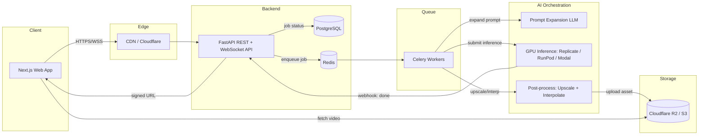

# AuditReady — Higgsfield AI Clone: System Blueprint

A complete architecture and implementation plan for a self-hosted alternative to
Higgsfield AI: a cinematic AI video generation platform with prompt-to-video,
image-to-video, camera motion control, and character consistency.

---

## 0. Product Scope

| Higgsfield feature            | Our equivalent                                                |
|--------------------------------|----------------------------------------------------------------|
| Text/Image → cinematic video   | T2V / I2V pipeline with model routing                          |
| "Director Mode" prompt control | LLM prompt-expansion service producing a structured scene spec |
| Camera motion presets           | ControlNet/LoRA-based camera conditioning (CameraCtrl/MotionCtrl) |
| Character consistency           | Reference-image conditioning (IP-Adapter) + optional LoRA       |
| Credits / generation history    | Postgres-backed jobs & billing model                            |

---

## 1. System Architecture



**Components**

- **Frontend** — Next.js (App Router) SPA/SSR hybrid. Talks to the backend over
  REST for CRUD and WebSocket/SSE for live generation progress.
- **Backend API** — FastAPI, stateless, horizontally scalable behind a load
  balancer. Owns auth, job creation, billing/credits, and asset URLs.
- **Queue** — Redis as broker/result-backend for Celery. Decouples the
  request/response cycle from long-running GPU work (a generation can take
  30s–5min, far beyond any HTTP timeout).
- **Workers** — Celery workers that orchestrate the AI pipeline: prompt
  expansion → keyframe generation → video generation → post-processing →
  upload. Workers are thin — the actual GPU compute is offloaded to a
  provider so workers themselves can run on cheap CPU instances.
- **GPU Inference layer** — Replicate/RunPod/Modal (see §2.4) run the
  actual diffusion models. Communicate via async job submission + webhook
  callback, not synchronous HTTP.
- **Object storage** — Cloudflare R2 (S3-compatible, no egress fees) for
  generated videos, thumbnails, and reference images, fronted by a CDN.
- **Database** — PostgreSQL for users, jobs, prompts, assets, credits.

### 1.1 Tech Stack

| Layer              | Choice                                   | Why |
|---------------------|-------------------------------------------|-----|
| Frontend framework  | Next.js 14+ (App Router, TypeScript)      | SSR for SEO landing pages, RSC for dashboard, huge ecosystem |
| UI                   | Tailwind CSS + shadcn/ui + Framer Motion  | Fast, accessible, easy to theme dark/cinematic UI |
| Client state          | TanStack Query + Zustand                 | Server cache + lightweight local UI state |
| Backend API           | FastAPI (Python 3.12)                    | Async-native, same language as the ML pipeline, auto OpenAPI docs |
| Auth                   | Clerk or Auth.js / self-rolled JWT + OAuth | Fast to ship; swap for self-rolled later if needed |
| Queue/broker            | Redis + Celery (or Redis + Arq for async-native workers) | Mature, battle-tested async task processing |
| Database                 | PostgreSQL (Neon / Supabase / RDS)       | Relational integrity for jobs/credits/users |
| Object storage             | Cloudflare R2 (S3 API compatible)        | Zero egress cost, cheaper than S3 at video scale |
| GPU inference               | Replicate (MVP) → RunPod Serverless / Modal (scale) → self-hosted (cost-optimized) | See §2.4 tradeoffs |
| Realtime updates             | WebSocket (FastAPI) or Server-Sent Events | Push job progress without polling |
| Infra/deploy                  | Vercel (web) + Fly.io/Render/AWS ECS (API+workers) + Terraform | Simple path to scale |
| Observability                   | Sentry + Grafana/Prometheus + Logtail    | Errors, GPU cost/latency dashboards |

---

## 2. Core AI Pipeline & Model Selection

### 2.1 Text-to-Video base models

| Model | Notes | License |
|---|---|---|
| **LTX-Video** (Lightricks) | Fast (real-time-ish on H100), good quality/speed tradeoff, open weights | Open, commercial-friendly |
| **CogVideoX-5B** (THUDM) | Strong prompt adherence, good motion coherence | Open (check commercial terms) |
| **Mochi-1** (Genmo) | High-fidelity motion, heavier compute | Apache 2.0 |
| **Open-Sora 2.0** | Fully open pipeline, good for self-hosting/fine-tuning | Apache 2.0 |
| **Hunyuan-Video** (Tencent) | SOTA open-weight quality, large (13B) | Open, community license |
| Commercial fallback: **Kling / Runway Gen-3 / Luma Dream Machine / Google Veo** via their APIs | Use when open models can't match quality bar for a "wow" launch demo | Paid API |

**Recommendation:** Start with **LTX-Video** or **CogVideoX** self-hosted (fast
iteration, controllable cost), and offer a "Pro" tier that proxies to a
commercial API (Kling/Runway) for top-tier output. This mirrors how
Higgsfield itself blends in-house and licensed models.

### 2.2 Image-to-Video

- **Stable Video Diffusion (SVD-XT)** — solid baseline, 25-frame clips,
  well-documented ComfyUI/diffusers support.
- **LTX-Video (I2V mode)** — same model family as T2V, keeps pipeline unified.
- **CogVideoX-I2V** — good for keeping character identity from a source image.

### 2.3 Camera & Character Motion Control ("Director Mode")

This is the core differentiator of Higgsfield — treat it as a **conditioning
layer** on top of the base video model, not a separate model:

- **CameraCtrl** — ControlNet-style adapter that injects camera pose
  trajectories (pan/tilt/dolly/zoom/orbit) into diffusion video models.
- **MotionCtrl** — similar, adds both camera trajectory AND object motion
  trajectory control.
- **AnimateDiff + Motion LoRAs** — if building on a SD1.5/SDXL video stack,
  motion LoRAs (zoom-in, pan-left, static, etc.) are the cheapest way to ship
  a first version of camera presets.
- **IP-Adapter / InstantID** — for character consistency across shots: embed
  a reference face/character image and condition generation on it without
  full fine-tuning.
- **Per-user LoRA training** (optional, premium tier) — train a small LoRA
  on 10–20 images of a user's character for persistent identity across
  generations. Run as an offline Celery job using `diffusers` + `peft`.

**Pipeline composition:**

```
[Text prompt] ─┐
               ├─► Prompt Expansion LLM ─► Structured Scene JSON
[Ref image?] ──┘        │
                         ▼
        { subject, action, camera: {type, speed, direction},
          lighting, style, negative_prompt, duration, aspect_ratio }
                         │
                         ▼
        Base T2V/I2V model + CameraCtrl/MotionCtrl conditioning
        + IP-Adapter (if reference image/character supplied)
                         │
                         ▼
        Raw video (e.g. 480p, 24fps, 4s)
                         │
                         ▼
        Post-process: RIFE frame interpolation (24→48fps)
                     + Real-ESRGAN / Topaz upscale (480p→1080p)
                         │
                         ▼
                  Final MP4 → R2 → CDN
```

### 2.4 Prompt Enhancement ("Director Mode") via LLM

Use Claude (or GPT-4o-class model) to convert a casual user prompt into a
structured, model-ready scene descriptor. This is what gives Higgsfield its
"cinematic" feel — the LLM fills in camera language, lighting, and pacing
the user didn't specify.

```python
# workers/pipeline/prompt_expansion.py
import json
from anthropic import Anthropic

client = Anthropic()

DIRECTOR_SYSTEM_PROMPT = """You are a cinematography director. Convert the
user's casual video idea into a structured JSON scene spec for a text-to-video
model. Infer camera movement, lighting, and pacing that fits the mood even if
unstated. Respond with JSON only, matching this schema:
{
  "subject": str, "action": str, "setting": str,
  "camera": {"shot_type": str, "movement": str, "speed": "slow"|"medium"|"fast"},
  "lighting": str, "style": str, "duration_seconds": int,
  "negative_prompt": str
}"""

def expand_prompt(user_prompt: str, reference_image_desc: str | None = None) -> dict:
    user_content = user_prompt
    if reference_image_desc:
        user_content += f"\n\nReference subject appears as: {reference_image_desc}"

    resp = client.messages.create(
        model="claude-sonnet-5",
        max_tokens=500,
        system=DIRECTOR_SYSTEM_PROMPT,
        messages=[{"role": "user", "content": user_content}],
    )
    return json.loads(resp.content[0].text)
```

### 2.5 GPU Hosting Options — Tradeoffs

| Option | Pros | Cons | Use when |
|---|---|---|---|
| **Replicate** | Zero infra, pay-per-second, huge model catalog, webhook support | Most expensive per-generation at scale, less control | MVP / Phase 1, validating demand |
| **RunPod Serverless** | Custom Docker, cheaper GPU-hour, autoscale to zero | You own the inference server code | Phase 2–3, once pipeline is stable |
| **Modal** | Python-native decorators, great DX, fast cold starts | Newer platform, pricing scales with usage | Great alternative to RunPod, especially for LLM+GPU mixed workloads |
| **Self-hosted (A100/H100 cluster, e.g. Lambda/CoreWeave/on-prem)** | Cheapest at high, sustained volume | Requires ops/DevOps investment, capacity planning | Phase 4, once volume justifies reserved capacity |

**Recommendation path:** Replicate → RunPod Serverless → hybrid (reserved
self-hosted for baseline load + serverless burst).

---

## 3. Backend & Queue Management

### 3.1 Async Job Pattern (avoiding request timeouts)

Video generation takes far longer than an HTTP request should be held open
for. The API must **never block** on generation — it enqueues and returns
immediately; the client polls or subscribes via WebSocket.

```
POST /api/generations
  → validate + deduct credits
  → insert `generations` row (status=queued)
  → enqueue Celery task `run_generation.delay(job_id)`
  → return { job_id, status: "queued" } immediately (202 Accepted)

Celery worker `run_generation(job_id)`:
  → status=expanding_prompt   → call LLM
  → status=generating         → submit to GPU provider (async job)
  → provider webhook OR poll  → status=post_processing
  → upload to R2              → status=completed, asset_url=...
  → push WS event to client

GPU provider webhook (Replicate/RunPod) → POST /api/webhooks/inference
  → verify signature
  → update job row / trigger next pipeline step
```

```python
# api/routers/generations.py
from fastapi import APIRouter, Depends
from api.tasks import run_generation
from api.db import get_db
from api.models import Generation

router = APIRouter()

@router.post("/generations", status_code=202)
async def create_generation(payload: GenerationRequest, user=Depends(current_user), db=Depends(get_db)):
    deduct_credits(db, user, cost=payload.estimated_cost())
    job = Generation(user_id=user.id, prompt=payload.prompt, status="queued",
                      params=payload.model_dump())
    db.add(job)
    await db.commit()

    run_generation.delay(str(job.id))
    return {"job_id": job.id, "status": job.status}

@router.get("/generations/{job_id}")
async def get_generation(job_id: str, db=Depends(get_db)):
    return await db.get(Generation, job_id)
```

```python
# workers/tasks.py
from celery import Celery
from workers.pipeline import prompt_expansion, video_gen, postprocess

app = Celery("worker", broker="redis://redis:6379/0", backend="redis://redis:6379/1")

@app.task(bind=True, max_retries=2)
def run_generation(self, job_id: str):
    job = load_job(job_id)
    try:
        update_status(job_id, "expanding_prompt")
        scene = prompt_expansion.expand_prompt(job.prompt)

        update_status(job_id, "generating")
        raw_video_path = video_gen.submit_and_wait(scene, job.params)

        update_status(job_id, "post_processing")
        final_path = postprocess.upscale_and_interpolate(raw_video_path)

        asset_url = upload_to_r2(final_path, job_id)
        update_status(job_id, "completed", asset_url=asset_url)
    except Exception as exc:
        update_status(job_id, "failed", error=str(exc))
        raise self.retry(exc=exc, countdown=10)
```

### 3.2 Database Schema (PostgreSQL)

```sql
CREATE TABLE users (
    id              UUID PRIMARY KEY DEFAULT gen_random_uuid(),
    email           TEXT UNIQUE NOT NULL,
    display_name    TEXT,
    credits         INTEGER NOT NULL DEFAULT 100,
    plan            TEXT NOT NULL DEFAULT 'free',  -- free | pro | studio
    created_at      TIMESTAMPTZ NOT NULL DEFAULT now()
);

CREATE TABLE generations (
    id               UUID PRIMARY KEY DEFAULT gen_random_uuid(),
    user_id          UUID NOT NULL REFERENCES users(id) ON DELETE CASCADE,
    status           TEXT NOT NULL DEFAULT 'queued',
        -- queued | expanding_prompt | generating | post_processing | completed | failed
    mode             TEXT NOT NULL,  -- text_to_video | image_to_video
    prompt_raw       TEXT NOT NULL,
    prompt_expanded  JSONB,
    params           JSONB NOT NULL, -- camera, motion strength, duration, aspect_ratio, model id
    reference_asset_id UUID REFERENCES assets(id),
    model_provider   TEXT,           -- replicate | runpod | modal | self_hosted
    provider_job_id  TEXT,
    error            TEXT,
    cost_credits     INTEGER NOT NULL,
    created_at       TIMESTAMPTZ NOT NULL DEFAULT now(),
    completed_at     TIMESTAMPTZ
);

CREATE TABLE assets (
    id              UUID PRIMARY KEY DEFAULT gen_random_uuid(),
    user_id         UUID NOT NULL REFERENCES users(id) ON DELETE CASCADE,
    generation_id   UUID REFERENCES generations(id) ON DELETE SET NULL,
    kind            TEXT NOT NULL,  -- video | thumbnail | reference_image
    storage_key     TEXT NOT NULL,  -- R2/S3 object key
    duration_seconds NUMERIC,
    width           INTEGER,
    height          INTEGER,
    created_at      TIMESTAMPTZ NOT NULL DEFAULT now()
);

CREATE TABLE credit_transactions (
    id              UUID PRIMARY KEY DEFAULT gen_random_uuid(),
    user_id         UUID NOT NULL REFERENCES users(id) ON DELETE CASCADE,
    generation_id   UUID REFERENCES generations(id),
    delta           INTEGER NOT NULL,  -- negative for spend, positive for purchase
    reason          TEXT NOT NULL,     -- generation | purchase | refund | signup_bonus
    created_at      TIMESTAMPTZ NOT NULL DEFAULT now()
);

CREATE INDEX idx_generations_user_status ON generations(user_id, status);
CREATE INDEX idx_assets_generation ON assets(generation_id);
```

### 3.3 Webhook Receiver (GPU provider callback)

```python
# api/routers/webhooks.py
@router.post("/webhooks/inference/{provider}")
async def inference_webhook(provider: str, request: Request, db=Depends(get_db)):
    body = await request.body()
    verify_signature(provider, request.headers, body)  # HMAC check per provider

    payload = await request.json()
    job_id = payload["metadata"]["job_id"]

    if payload["status"] == "succeeded":
        await enqueue_postprocess(job_id, payload["output_url"])
    elif payload["status"] == "failed":
        await update_status(job_id, "failed", error=payload.get("error"))

    return {"ok": True}
```

---

## 4. Frontend User Interface (UI/UX)

### 4.1 Key Pages

| Route | Purpose |
|---|---|
| `/` | Marketing landing page + gallery of example generations |
| `/studio` | Main creation workspace: prompt input, camera controls, reference upload, generate button |
| `/dashboard` | Grid of user's past generations with status badges |
| `/generation/[id]` | Full video player, download, remix ("use as new reference"), share |
| `/settings/billing` | Credits balance, plan upgrade, usage history |

### 4.2 Studio Components

- **`<PromptComposer />`** — textarea + "Enhance with Director Mode" toggle
  that calls the LLM expansion endpoint and shows the structured scene
  preview before submit.
- **`<ReferenceImageUploader />`** — drag-drop, uploads directly to R2 via
  presigned URL, shows thumbnail.
- **`<CameraControlPanel />`** — preset chips (Static, Pan Left/Right, Zoom
  In/Out, Orbit, Dolly In/Out, Crane Up/Down) that map to CameraCtrl
  trajectory params, plus a "custom" mode with a draggable path.
- **`<MotionStrengthSlider />`** — 0–100 slider controlling how much motion
  vs. how faithful to the reference frame.
- **`<AspectRatioSelector />`** — 16:9 / 9:16 / 1:1 chips.
- **`<GenerationProgress />`** — subscribes to WebSocket, renders a
  step-indicator (Queued → Directing → Rendering → Upscaling → Done).
- **`<VideoGallery />` / `<VideoPlayerCard />`** — grid with hover-to-preview,
  uses `react-player` or native `<video>` with lazy-loaded poster frames.

```tsx
// app/studio/page.tsx (excerpt)
"use client";
import { useGenerationSocket } from "@/hooks/useGenerationSocket";
import { useCreateGeneration } from "@/hooks/useCreateGeneration";

export default function StudioPage() {
  const { mutate: createGeneration, data: job } = useCreateGeneration();
  const progress = useGenerationSocket(job?.job_id);

  return (
    <div className="grid grid-cols-[1fr_380px] gap-6 p-6">
      <div className="space-y-4">
        <PromptComposer onSubmit={(scene) => createGeneration(scene)} />
        <CameraControlPanel />
        <MotionStrengthSlider />
      </div>
      <aside className="space-y-4">
        <ReferenceImageUploader />
        <AspectRatioSelector />
        {job && <GenerationProgress status={progress?.status ?? job.status} />}
      </aside>
    </div>
  );
}
```

```tsx
// hooks/useGenerationSocket.ts
import { useEffect, useState } from "react";

export function useGenerationSocket(jobId?: string) {
  const [status, setStatus] = useState<GenerationStatus | null>(null);

  useEffect(() => {
    if (!jobId) return;
    const ws = new WebSocket(`${process.env.NEXT_PUBLIC_WS_URL}/ws/generations/${jobId}`);
    ws.onmessage = (e) => setStatus(JSON.parse(e.data));
    return () => ws.close();
  }, [jobId]);

  return status;
}
```

### 4.3 UI Stack

- **Tailwind CSS** for styling, **shadcn/ui** for accessible primitives
  (Dialog, Slider, Tabs, Toast).
- **Framer Motion** for the cinematic feel — page transitions, progress-step
  animations, hover video previews.
- **TanStack Query** for server state (generations list, job polling
  fallback if WebSocket drops).
- **Zustand** for ephemeral studio state (current prompt draft, selected
  camera preset) so it survives navigation within the studio.

---

## 5. Implementation Roadmap

### Phase 1 — MVP (Weeks 1–3)
- Repo scaffold (see §6), CI (lint/typecheck/test on PR).
- Auth (email/OAuth via Clerk or Auth.js) + Postgres schema + migrations.
- Basic Studio UI: prompt textarea, aspect ratio, generate button.
- Single model integration via **Replicate** (e.g. LTX-Video or SVD),
  synchronous submit + Celery poll (webhook optional at this stage).
- Dashboard listing generations with status polling.
- **Exit criteria:** a logged-in user can type a prompt and get a playable
  video back end-to-end.

### Phase 2 — GPU Integration & Scale-out (Weeks 4–6)
- Add image-to-video mode + reference image upload (presigned R2 URLs).
- Move from polling to Replicate/RunPod **webhooks** for job completion.
- Add credits/billing model + Stripe checkout for credit packs.
- Add RunPod Serverless as a second provider behind a provider-abstraction
  interface (`InferenceProvider.submit(scene) -> job_handle`), enabling
  A/B cost & quality comparison.
- WebSocket-based live progress (replace polling in UI).

### Phase 3 — Advanced Controls (Weeks 7–10)
- Integrate **CameraCtrl/MotionCtrl** conditioning for camera presets.
- Ship **Director Mode** LLM prompt expansion (§2.4) with a preview/edit
  step before generation.
- Add **IP-Adapter**-based character consistency from a reference image.
- Optional: per-user LoRA training job (premium tier) with training-status
  UI.
- Post-processing pipeline: RIFE interpolation + Real-ESRGAN upscale as a
  separate Celery stage (parallelizable, cacheable).

### Phase 4 — Optimization & Scaling (Weeks 11+)
- Move steady-state load to reserved self-hosted GPUs (CoreWeave/Lambda),
  keep RunPod/Modal for burst capacity — hybrid autoscaling.
- Add result caching (identical prompt+params hash → reuse asset).
- Add queue priority tiers (Pro users skip the line).
- Observability: per-model latency/cost dashboards, GPU utilization
  alerts, generation success-rate SLOs.
- CDN cache tuning, video transcoding to multiple resolutions (HLS) for
  adaptive playback.
- Load-test the webhook + Celery path for burst traffic (e.g. viral launch
  day) and add backpressure (queue depth → dynamic credit-cost surcharge
  or "estimated wait time" UI).

---

## 6. Repository Structure

```
.
├── apps/
│   ├── web/                 # Next.js frontend
│   │   ├── app/
│   │   │   ├── studio/
│   │   │   ├── dashboard/
│   │   │   ├── generation/[id]/
│   │   │   └── settings/
│   │   ├── components/
│   │   ├── hooks/
│   │   └── lib/
│   └── api/                 # FastAPI backend
│       ├── routers/         # generations.py, webhooks.py, users.py
│       ├── models/          # SQLAlchemy models
│       ├── db.py
│       └── main.py
├── workers/                 # Celery workers + AI pipeline
│   ├── tasks.py
│   └── pipeline/
│       ├── prompt_expansion.py
│       ├── video_gen.py         # provider abstraction (Replicate/RunPod/Modal)
│       ├── camera_control.py    # CameraCtrl/MotionCtrl conditioning
│       ├── character.py         # IP-Adapter / LoRA
│       └── postprocess.py       # upscale + interpolate
├── infra/
│   ├── docker/
│   ├── terraform/
│   └── migrations/          # Alembic
└── docs/
    └── api-workflow.md
```

---

## 7. Example End-to-End API Workflow

```
1. POST /api/auth/login                    → session/JWT
2. POST /api/assets/presign                → { upload_url, asset_id }  (if using reference image)
   PUT  {upload_url}                       → client uploads image directly to R2
3. POST /api/generations
   { "mode": "image_to_video", "prompt": "...", "reference_asset_id": "...",
     "camera": {"movement": "orbit", "speed": "medium"},
     "aspect_ratio": "16:9", "duration_seconds": 4 }
   → 202 { "job_id": "...", "status": "queued" }
4. WS  /ws/generations/{job_id}            → streamed status updates
5. GET /api/generations/{job_id}           → fallback poll; final response includes asset_url
6. GET {asset_url}                         → CDN-served MP4
```

---

## Summary

Ship Phase 1 on Replicate to validate product-market fit fast with minimal
infra investment, then progressively own more of the GPU pipeline
(RunPod → self-hosted) as volume justifies the engineering cost. The
architectural bet that most differentiates this from a generic "SD video
wrapper" is the **Director Mode prompt-expansion + camera/motion
conditioning layer** (§2.3–2.4) — invest there once the core generate loop
is reliable.
